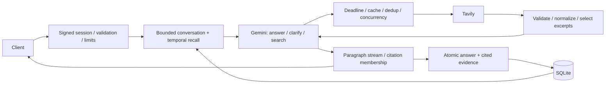

<!-- coderabbit-ai-generated:v1 -->

<!-- coderabbit-ai-generated-section:v1:4e4489683e1deaba44ae530bb293bfc0b93bfe5694343fa72ba59b1ef96ed066 -->

<!-- coderabbit-ai-generated-section:v1:27855c8999cf9902e1388ad5b8881ef5120ef1036182739e245e4310b23afecb -->

# Design

## Architecture
One Next.js Node application, one Gemini model-directed loop, one `web_search` tool, and SQLite on durable local storage. No planner model, vector database, or distributed services.

## Request and evidence contracts
The server ignores client history and identities, accepts only the latest question, and loads owned conversation history. Signed anonymous cookies plus conversation UUIDs scope storage. Reload restores the latest 20 completed messages. Explicit recall can span the same signed user’s conversations; ordinary recent context remains conversation-scoped. Recall runs before saving a pending question. Failed questions are excluded from recall. Date parsing uses the user's timezone and local day boundaries, including DST; explicit intervals use their end date. The first temporal expression is selected; complex multiple-date interpretation remains a limitation.

The model answers stable facts directly, reuses supplied evidence for follow-ups, clarifies material ambiguity, and searches uncertain/current facts. These decisions are instructions, not guarantees. The third model step disables tools, reserving synthesis. Limits: three model steps, six search executions, 1,800 output tokens per step, 45-second request deadline. Independent provider requests run three at a time. Current prices use unfiltered current-state search; dated announcements use `start_date`.

Search validates schemas and HTTP(S) URLs, strips tracking parameters, deduplicates URLs, filters low provider relevance scores, and keeps up to eight 1,200-character excerpts. Provider scores do not establish authority. The process-local cache holds 256 entries, with five-minute TTL for fresh/pricing queries and one hour otherwise. Concurrent identical misses share work with their own eight-second deadline. One retry handles 429/5xx. Subscriber cancellation does not cancel other subscribers' shared search.

History has a 16,000-character budget; stored evidence is limited to 20 records. Historical content is serialized as untrusted user-level data rather than system instructions. Citation links are checked against supplied evidence, buffered by paragraph to handle split links. Only actually cited evidence is saved with excerpt and retrieval/publication timestamps. Membership is not proof of factual entailment.

## Reliability and deployment
SQLite WAL, a bounded busy timeout, additive schema upgrades, non-replacing message inserts, and atomic answer/source persistence. Requests have pending/completed/failed states. A per-process admission cap and one active request per conversation bound work; these are single-instance protections, not distributed rate limiting. Production requires a stable SESSION_SECRET of at least 32 characters, HTTPS, durable DATABASE_PATH, restricted filesystem access and backups. Losing the cookie loses anonymous access; this is not account authentication.

## Evaluation and limitations
`npm test` runs isolated temporal/database tests, 20 preprocessing cases, and regression tests including the actual SDK loop with a scripted model and search. `npm run lint` type-checks; `npm run build` builds. `npm run benchmark -- /tmp/run.json` runs eight optional live scenarios and records answers, latency, usage, calls and human-review fields for comparisons. No claim of live answer accuracy or production p95 is made. Logs report latency, steps, calls, usage and finish reason without prompt contents.

Deliberate contract changes: validated historical evidence may be cited without a fresh search; material ambiguity warrants clarification. Three dated non-recall fixtures now correctly expect no history selection. Semantic relevance/entailment scoring, selective page extraction, fallback providers, retention automation, and distributed deployment remain future work. Dependency audit advisories require a separately validated major-version migration before production release.

<!-- /coderabbit-ai-generated:v1 -->